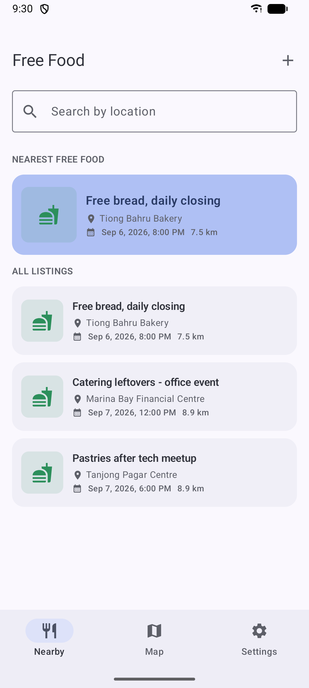
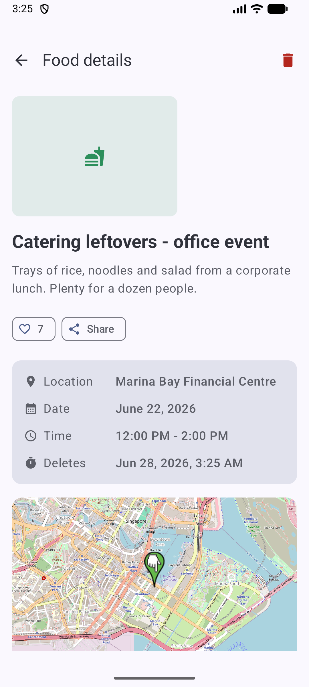
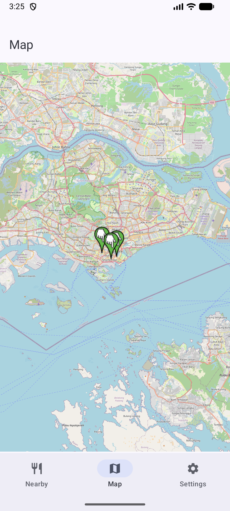
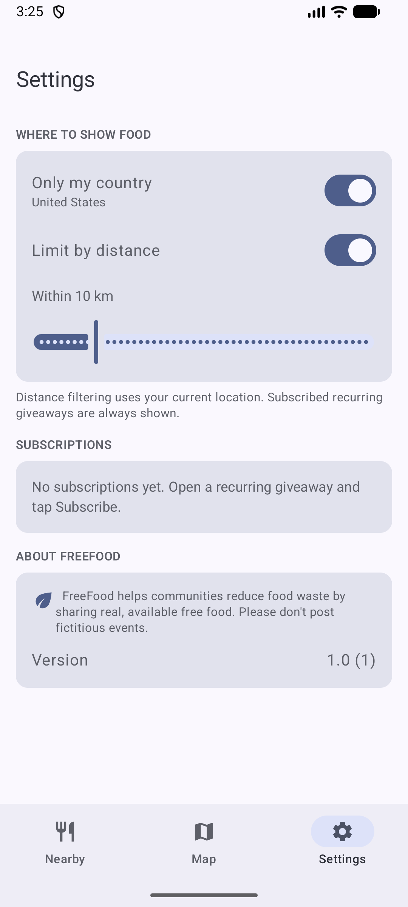
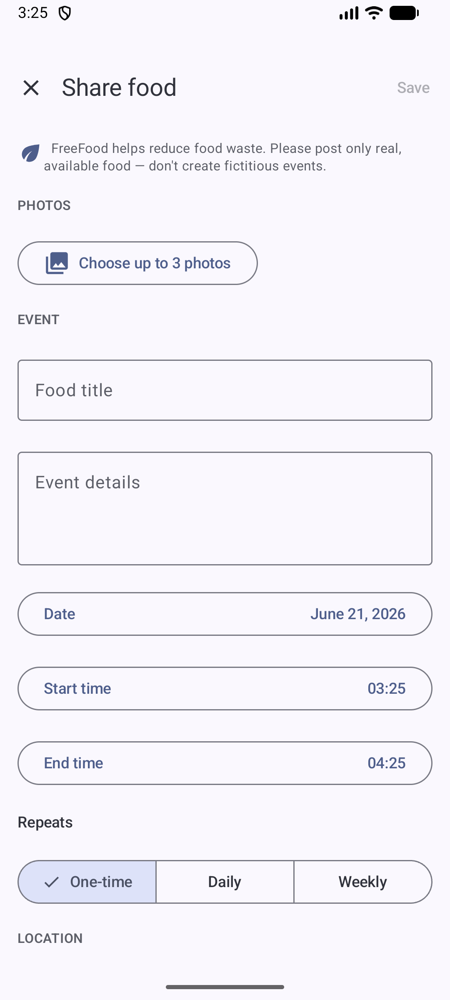

<div align="center">

# FreeFood (Android)

[](https://kotlinlang.org/)
[-3DDC84.svg)](https://developer.android.com/)
[](https://developer.android.com/jetpack/compose)
[](https://m3.material.io/)
[](https://github.com/osmdroid/osmdroid)
[](#license)

**A native Android app for sharing leftover food nearby and reducing food waste.**

[](https://play.google.com/store/apps/details?id=com.tertiaryinfotech.freefood)

[Report Bug](https://github.com/alfredang/freefoodapp_android/issues) · [Request Feature](https://github.com/alfredang/freefoodapp_android/issues)

</div>

## Screenshots

| Nearby feed | Listing detail | Map | Settings | Share food |
| --- | --- | --- | --- | --- |
|  |  |  |  |  |

## About

FreeFood is a Jetpack Compose Android app for posting and discovering free leftover food
from events, offices, meetups, and community spaces. It is a faithful native port of the
[iOS FreeFood app](https://github.com/alfredang/freefoodapp): create a listing with
photos, location, schedule and details; browse a searchable feed that surfaces the
nearest available food first; and view everything on a map.

### Key Features

| Feature | Description |
| --- | --- |
| Food listings | Add food title, details, date, start time, end time, and up to 3 photos. |
| Location search | Search places by name with the platform Geocoder when choosing pickup. |
| Nearby feed | Highlights the nearest available listing when location access is enabled. |
| Search | Filter listings by location, title, or event details. |
| Map view | Browse listings as map markers and open details from the map. |
| Recurring giveaways | Bakeries/stalls post a daily or weekly giveaway once; it rolls forward automatically. |
| Subscriptions | Follow recurring giveaways so they always show, regardless of filters. |
| Country & distance filters | Choose how far away and in which country to show food. |
| Auto-expiry | One-time posts are purged after they end (and within 7 days) to keep the feed fresh. |

## Tech Stack

| Layer | Technology |
| --- | --- |
| UI | Jetpack Compose, Material 3, Navigation Compose |
| Maps | osmdroid (OpenStreetMap) — no API key required |
| Location | Google Play Services Fused Location |
| Place search | Android `Geocoder` |
| State | `ViewModel` + Kotlin `StateFlow` |
| Persistence | Room (listings) + Jetpack DataStore (settings) |
| Images | Photo Picker + Coil; photos copied to internal storage |
| Build | Gradle 8.11 (Kotlin DSL + version catalog), AGP 8.7, Kotlin 2.0 |
| Min / Target SDK | 26 (Android 8.0) / 35 (Android 15) |

## Architecture

```text
FreeFood (Android)
│
├── MainActivity ──► FreeFoodTheme ──► MainScreen (bottom-nav Scaffold + NavHost)
│
├── ui/screens
│   ├── ListingFeedScreen     Nearby feed + search + nearest highlight
│   ├── FoodMapScreen         osmdroid markers + tap-to-open card
│   ├── AddListingScreen      Share-food form + human-check captcha
│   ├── ListingDetailScreen   Photos, like/share/subscribe, info, map
│   └── SettingsScreen        Country/distance filters, subscriptions
│
├── ui/vm/FoodViewModel       Combines listings + settings + location into UI state
│
├── data
│   ├── FoodListingRepository  Single source of truth (Room-backed, cloud-swappable)
│   ├── AppDatabase / Dao      Room persistence
│   └── AppSettings            DataStore preferences (mirrors iOS UserDefaults)
│
├── location
│   ├── LocationManager        Current location (Fused Location)
│   └── LocationSearchService  Forward geocoding (Geocoder)
│
└── model/FoodListing          Domain model + recurrence / expiry / distance logic
```

### Mapping from the iOS app

| iOS (SwiftUI) | Android (this app) |
| --- | --- |
| `SwiftUI` + `TabView` | Jetpack Compose + Material 3 bottom navigation |
| `MapKit` | osmdroid (OpenStreetMap) |
| `CoreLocation` | Fused Location Provider |
| `MKLocalSearch` | Android `Geocoder` |
| CloudKit public DB | Room (local) behind a repository — pluggable for a shared backend |
| `UserDefaults` | Jetpack DataStore |
| `PhotosUI` | Android Photo Picker + internal-storage copies |

> The iOS app shares listings through the CloudKit public database. This port keeps the
> same repository surface but stores listings locally (Room) and seeds a few sample
> listings on first launch, so it runs with **no backend, accounts, or API keys**. A
> shared cloud backend (Firebase Firestore, a REST API, …) can be dropped in behind
> `FoodListingRepository` without touching the UI.

## Getting Started

### Prerequisites

- Android Studio (Koala or newer) with Android SDK 35 + build-tools 35
- JDK 17+ (the Android Studio bundled JBR works)

### Build & run

```sh
git clone https://github.com/alfredang/freefoodapp_android.git
cd freefoodapp_android
./gradlew :app:installDebug      # build + install on a connected device/emulator
# or open the project in Android Studio and press Run.
```

### Build a signed release

Signing is read from a git-ignored `keystore.properties` at the repo root:

```properties
storeFile=keystore/freefood-release.jks
storePassword=********
keyAlias=freefood
keyPassword=********
```

```sh
./gradlew :app:bundleRelease     # -> app/build/outputs/bundle/release/app-release.aab  (Play upload)
./gradlew :app:assembleRelease   # -> app/build/outputs/apk/release/app-release.apk      (sideload)
```

## Google Play

FreeFood is available to **[download from Google Play](https://play.google.com/store/apps/details?id=com.tertiaryinfotech.freefood)**.
Store listing assets (copy, 512 icon, 1024×500 feature graphic, and phone screenshots)
live in `fastlane/metadata/android/en-US/`. See **[PLAY_STORE.md](PLAY_STORE.md)** for
the Play Console and Fastlane release workflow.

## Data & Privacy

- Listings and your settings are stored **on your device** (Room + DataStore).
- Location is used only to rank nearby listings and center the map; it never leaves the device.
- Photos are selected via the system Photo Picker and copied into app-private storage.
- No account, sign-in, or password is required.

## Roadmap

- Shared community backend (Firebase Firestore / REST) behind the existing repository.
- Listing moderation and reporting.
- Push notifications for subscribed recurring giveaways.
- Wider tablet / foldable layouts and UI tests.

## Developed By

Tertiary Infotech Academy Pte. Ltd.

## License

No license file is currently included. Add a license before distributing or accepting
external contributions.
